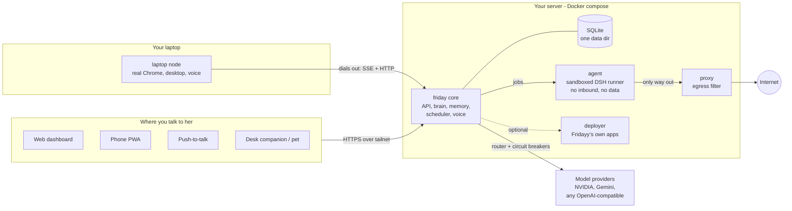
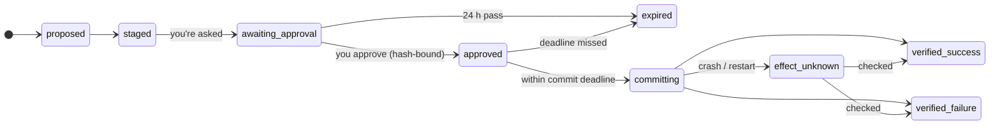

<div align="center">



<br>

**Fridayy is an autonomous AI agent that does your computer work for you.**<br>
Hand her the job — the research, the emails, the forms, the clicking through websites on your laptop — and get the result back.

<br>

[](https://github.com/atharvb7/friday/actions/workflows/ci.yml)


[](LICENSE)

[**Why Fridayy**](#why-fridayy) · [**Hand it over**](#hand-it-over) · [**Features**](#what-she-can-do) · [**Architecture**](#architecture) · [**Quick start**](#quick-start) · [**Deploy**](#deploy-to-a-server) · [**Status**](#honest-status)

</div>

---

## Why Fridayy

For decades, people have spent their days sitting in front of a computer doing the work themselves: opening
tabs, copying things between apps, filling in forms, chasing emails, digging through search results.

**Fridayy ends that.** You say what you want done — by chat, by voice, from your phone — and she does it:
she plans it, uses the tools, opens your laptop's real browser and apps when the job needs them, works in the
background for as long as it takes, and comes back with the result. Your computer works for you, not the other way round.

```text
You    ▸ find three freight forwarders in Pune with weak websites, write each of them
         an intro email, and remind me tomorrow at 10 to check the replies

Fridayy ▸ On it.
         ⋯ researching 14 companies, auditing their websites ⋯
         ⋯ drafting 3 personalised emails from your outreach inbox ⋯
         Done. Three companies, each with the page that shows the problem,
         and three drafts ready to send. Reminder set for 10:00 tomorrow.
         Sending emails goes out in your name, so: send all three?
```

| | |
|---|---|
| 🤖 **Autonomous** | Give her a goal, not steps. She plans, splits big jobs into parallel subtasks, uses the right agent for each, retries around problems and reports back. |
| 💻 **Uses your computer** | A laptop node lets her drive your real, logged-in Chrome and desktop apps — clicking, typing, uploading — exactly as you would, while you do something else. |
| ⏰ **Works while you don't** | Runs 24/7 on your own server: background jobs, recurring work, watches, a morning briefing, and pipelines that keep running overnight. |
| 🧠 **Remembers and learns** | One persistent memory of you, your goals and your work. Every job she finishes turns into a playbook, so the next one is faster. |
| ✋ **Asks only when it matters** | Routine work just happens. Sending in your name, spending money or deleting things pauses for one tap — and you choose how much she may do alone. |
| 🪶 **Lean and yours** | Self-hosted, zero-dependency Node 22 server. The core idles at ~80 MiB and fits on a 6 GB box with no GPU. |

---

## Hand it over

Anything you would otherwise sit at a computer for:

| You say | Fridayy does |
|---|---|
| *"Research the top 5 competitors and give me a report"* | Runs a research agent across the web, keeps sources with dates, flags contradictions, writes the report |
| *"Fill in this registration form on that site"* | Opens it in your real Chrome on the laptop, fills it from your saved details, shows you the result |
| *"Clean up my inbox and draft replies to anything urgent"* | Searches, labels and organises Gmail, writes drafts in your voice |
| *"Find me clients and keep doing it every day"* | A 24/7 pipeline: finds companies, audits their websites, qualifies them, drafts outreach |
| *"Turn these notes into a deck and a one-page PDF"* | Creates Word / Excel / PowerPoint / PDF files and edits them in versions |
| *"Build a small app for this and put it online for me"* | A coding agent writes it in a sandbox and deploys it on your tailnet |
| *"Keep an eye on this page and tell me when the price drops"* | Sets up a watch and pings you when it happens |
| *"Reply to this Instagram DM thread for the next hour"* | Runs a time-boxed conversation on your behalf, showing you every message |
| *"What does this error on my screen mean?"* | Push-to-talk from any app: she looks at your screen and answers out loud |

---

## What she can do

<table>
<tr>
<td width="50%" valign="top">

### 🤖 Autonomous agents
- **DSH agents** for research and coding in a bubblewrap / container sandbox, behind a filtering egress proxy
- **Team tasks**: a big goal split into parallel subtasks across runtimes, merged into one report
- **Hermes Agent** as a delegated runtime, with its approvals bridged into Fridayy's
- **Self-learning playbooks**: successful runs become `SKILL.md` hints for next time
- 35 skills (research, coding, sales, writing), third-party ones pinned and reviewed — see [`skills/`](skills)

</td>
<td valign="top">

### 💻 Computer use on your laptop
- Dials **out** to the server — the server never reaches into your laptop
- Drives your real Chrome with **DOM refs**, not guessed coordinates
- Whole-desktop control via AT-SPI accessibility (works on Wayland): open apps, read and press controls
- Personal details are **placeholders** (`{{profile.phone}}`) filled at type-time; the model never sees them
- A self-guard stops the agent from ever operating Fridayy's own approval page

</td>
</tr>
<tr>
<td valign="top">

### ⏰ Always on
- Reminders + recurring jobs (daily / weekdays / weekly / monthly), timezone- and DST-correct, never double-fire
- **Watches**: "keep an eye on X and tell me when Z"
- Proactive loop: morning briefing, stuck tasks, brain down, low disk — with quiet hours and a daily cap
- **"Your turn" board**: one list of everything waiting on you (decide / answer / check / do)
- **Away days**: hold back briefings, nudges and outreach while you're away
- Health for every background loop, spend tracking per provider

</td>
<td valign="top">

### 💼 Business mind
- **Prospector**: a 24/7 pipeline — source → audit the company's own site → keep only on-page evidence → qualify → draft
- Built-in CRM: leads, history, a do-not-contact list, a business profile every sales skill reads first
- Jurisdiction-aware cold email rules (UK/EU, DE/AT, …) and opt-out footers
- Outreach from a **separate inbox**, one approval per batch, replies watched
- Typed sales judgments via JEV, with deterministic fallbacks

</td>
</tr>
<tr>
<td valign="top">

### 🔌 Apps & content
- **Gmail** via your own Google OAuth client (refresh token never reaches the model, UI or logs)
- **Instagram** through Composio — reads free, anything public or social needs approval, unknown actions refused
- **WhatsApp / Instagram DM sessions** for a bounded time, on your say-so
- **Documents**: create / read / edit Word, Excel, PowerPoint, PDF, Markdown — every edit is a new version
- **Images** (FLUX on NVIDIA) and an automated **reel** pipeline

</td>
<td valign="top">

### 🗣️ Bodies & voice
- **Web dashboard + phone PWA** (no build step): streaming chat, inbox, tasks with traces, memory, settings
- **Voice**: Whisper for listening, Kokoro for speaking, on-demand worker that unloads when idle
- **Push-to-talk** from any laptop app, with screen-aware questions ("what does this error mean?")
- Web Push, SSE live state, a derived **companion state** shared by every body
- Desktop pet (Tauri) and ESP32-S3 desk companion scaffolds

</td>
</tr>
<tr>
<td valign="top">

### 🧠 Brain
- **Model router** with per-role chains (`chat`, `execute`, `reason`, `plan`, `vision`, `embed`), circuit breakers,
  daily-quota awareness and a call log with latency + tokens
- Nemotron 3.5 Super for everyday turns, Ultra / Gemini Flash for deep reasoning, any OpenAI-compatible fallback
- **Tool loading**: each turn gets only the tool groups it needs (~12k → a fraction of the tokens)
- Streaming tool-calling loop with step budgets and a "stop retrying the same call" guard
- Personality sliders + mood — **style only**, never permissions

</td>
<td valign="top">

### 📚 Memory & knowledge
- Hybrid memory: SQLite FTS + `nemotron-3-embed-1b` vectors, fused with RRF
- **Auto-memory**: durable facts and preferences extracted after each exchange (editable, deletable)
- Research memory: sources with dates, claims with confidence, **contradiction flags**
- Goals with a rolling digest, commitments as first-class to-dos
- **Suggestions ledger**: every recommendation is filed with evidence and scored later — worked / mixed / failed

</td>
</tr>
</table>

---

## Architecture



**Design rules the code sticks to**

- **One composition root.** Every service is built once in [`src/context.mjs`](src/context.mjs); routes and tools receive what they need.
- **Outbound only.** The laptop node and the agent container connect *out*. Nothing reaches into your laptop; the agent can't reach your LAN, tailnet or cloud metadata.
- **Data in one place.** DB, tokens, agent homes and workspaces live under `FRIDAY_DATA_DIR`. Moving machines is `friday backup` → copy → `friday restore`.
- **Least privilege at the edges.** Containers run read-only with all capabilities dropped and hard memory / pid limits; the core is published on `127.0.0.1` only.

---

## Autonomy you control

Fridayy works on her own by default. The few things that really matter — speaking in your name, spending money,
deleting, security — wait for a single tap, and you decide where that line sits for each kind of work.
It's enforced in code, not in the prompt, so it holds even when a web page tries to talk her into something.

<details>
<summary><b>How it works under the hood</b></summary>

| Layer | What it does |
|---|---|
| **Autonomy tiers** | Per category (`ask` · `trusted` · `autonomous` · `high`). Money, deletion, messaging other people and security ask first by default. `high` is time-boxed (≤ 12 h) and revoked by the emergency stop. |
| **Exact-payload approvals** | You approve *this exact* email / post / click. The payload is hashed; a tampered or replayed approval fails. Execute-once, 24 h expiry. |
| **Effect ledger** | Every external side effect moves through a state machine with a commit deadline, so a crash mid-action shows up as *unknown* for you to check — never silently retried. |
| **TOTP on devices** | Approving from a phone or another device needs an authenticator code. Device tokens are scoped, hashed and revocable. |
| **Emergency stop** | One button (or "stop everything") cancels running work and drops elevated autonomy. |
| **Audit chain** | Append-only, SHA-256 hash-chained log of everything that happened. Never pruned. |
| **Sandboxing** | Agents see only their workspace; the data dir, `.env` and your home are hidden. Egress goes through a proxy that blocks private, LAN, tailnet and metadata addresses. SSRF-safe `web_fetch`. |
| **Resource governor** | A hard memory budget gates admission of new work, so the box never swaps itself to death. |
| **Members are isolated** | Other people can request an account; once you approve, they get their own chats and **no** access to your laptop, mail, memory, tasks or settings. |

**Life of an action that needs your OK:**



</details>

Independent reviews live in [`docs/security-audit-2026-10-10.md`](docs/security-audit-2026-10-10.md) and
[`docs/review-2026-10-28.md`](docs/review-2026-10-28.md), including the items that are still open.

---

## Quick start

> [!NOTE]
> Requires **Node ≥ 22.13** (the server has no npm dependencies), `bubblewrap` for local agents, and Google Chrome
> only on the machine running the laptop node.

```bash
git clone https://github.com/atharvb7/friday.git && cd friday
cp .env.example .env && chmod 600 .env       # add FRIDAY_NVIDIA_API_KEY (and optional keys below)
node bin/friday.mjs doctor                   # checks everything and tells you what's missing
node bin/friday.mjs start                    # → http://127.0.0.1:4317  (token in data/access-token)
```

Open `http://127.0.0.1:4317`, paste the token, and say hi.

<details>
<summary><b>Everyday CLI</b></summary>

```bash
node bin/friday.mjs status | logs -f | stop | restart
node bin/friday.mjs device add phone read,chat,tasks,approve   # prints a scoped device token once
node bin/friday.mjs totp                                       # set up the authenticator for device approvals
node bin/friday.mjs voice setup                                # install Whisper + Kokoro
node bin/friday.mjs backup [dir] | restore <file.tgz>          # secrets excluded unless --with-secrets
```

</details>

<details>
<summary><b>Connect your phone</b></summary>

Put Fridayy behind Tailscale HTTPS (tailnet-only), open the URL on your phone and install the PWA:

```bash
tailscale serve --https=443 http://127.0.0.1:4317
```

See [`docs/tailscale-runbook.md`](docs/tailscale-runbook.md).

</details>

<details>
<summary><b>Pair your laptop (computer use)</b></summary>

```bash
node bin/friday.mjs device add laptop read,node                    # on the server: prints a token once
cd node && npm install                                             # on the laptop: playwright-core only
FRIDAY_NODE_TOKEN=fdv_... node friday-node.mjs pair --server https://<friday-host> --name laptop
node friday-node.mjs run
```

Full guide, permissions and the push-to-talk key: [`node/README.md`](node/README.md).

</details>

---

## Deploy to a server

Fridayy ships as a hardened Docker compose stack sized for a **6 GB RAM, no-GPU** Linux box:

| Container | Role | Limits |
|---|---|---|
| `friday` | core: API, UI, brain, scheduler, voice | 2.5 GB · read-only · `127.0.0.1` only |
| `agent` | sandboxed DSH runner — no inbound, no Fridayy data | 2 GB · internal network only |
| `proxy` | the agent's only way out; blocks private / LAN / tailnet / metadata | 128 MB |
| `deployer` *(profile `apps`)* | hosts Fridayy's own apps on the tailnet, fixed tiny API | optional |

```bash
docker compose up -d --build
```

Step-by-step setup, rolling back data after a bad deploy, Gmail OAuth and measured resource numbers:
[`docs/DEPLOY-SERVER.md`](docs/DEPLOY-SERVER.md).

---

## Configuration

Everything is environment variables in `.env` ([`.env.example`](.env.example) documents each one). The ones that matter first:

| Variable | Purpose |
|---|---|
| `FRIDAY_NVIDIA_API_KEY` | Main brain (Nemotron), embeddings, vision, images |
| `FRIDAY_GEMINI_API_KEY` | Optional: Gemini for reasoning / planning / vision (`FRIDAY_GEMINI_ROLES` widens it) |
| `FRIDAY_FALLBACK_BASE_URL` · `_API_KEY` · `_MODEL` | Any OpenAI-compatible provider as a last-resort fallback |
| `FRIDAY_MODELS_CHAT` · `FRIDAY_MODELS_REASON` | Override a role's chain, e.g. `nvidia:model-a,fallback:model-b` |
| `SERPAPI_API_KEY` | Web search for the brain and agents |
| `FRIDAY_DSH_BIN` | Path to the DSH agent runtime |
| `GITHUB_TOKEN` | Enables the GitHub MCP server for coding agents |
| `FRIDAY_DATA_DIR` | Where everything lives (default `./data`) |
| `FRIDAY_RESOURCE_PROFILE` | Memory budget profile (e.g. `server6g`) |

Keys are referenced by env-var **name** only — they never go into prompts, logs or agent homes.

---

## Project layout

```text
bin/friday.mjs           CLI: start · stop · status · doctor · device · totp · backup · restore
src/context.mjs          composition root — every service built once
src/ai/                  model router, OpenAI-compatible provider, memory indexer
src/agent/               brain, tool loading, computer agent, team, self-learning, auto-memory
src/routes/  src/http/   HTTP API + SSE
src/policy.mjs           autonomy tiers          src/approvals.mjs  exact-payload approvals
src/effects.mjs          side-effect ledger      src/audit.mjs      hash-chained audit
src/prospector.mjs       client-hunting pipeline src/pipeline.mjs   CRM + outreach
public/                  dashboard + phone PWA (plain JS, no build step)
node/                    laptop node: Playwright + AT-SPI + push-to-talk
agent-runner/ egress-proxy/ deployer/ deploy/   containers
voice/  docs-engine/     Python workers: speech, documents
skills/                  SKILL.md folders (third-party ones pinned in THIRD_PARTY.md)
physical/ desktop-pet/   ESP32 companion + Tauri pet
test/                    hermetic test suite (fake models and agents)
```

---

## Testing & benchmarks

```bash
npm test            # 315 hermetic server tests — no network, fake model and agent engines
npm run test:node   # laptop node + real-Chrome UI tests
npm run check       # syntax check of the entry points
```

CI runs all three on every pull request. The brain itself is measured by a benchmark that runs the real prompt,
tools, guards and router against a fixed stubbed world — **38/39** on the 27 Oct baseline, with ~60% fewer input
tokens than before tool loading. Method and full table: [`docs/benchmarks/2026-10-27-baseline.md`](docs/benchmarks/2026-10-27-baseline.md).

---

## Honest status

Things are only ticked when they work end to end and a test or a measurement proves it.
The full, dated list is [`docs/ROADMAP.md`](docs/ROADMAP.md).

| ✅ Verified live | 🟡 Built, not yet proven on target | 🔭 Next |
|---|---|---|
| Brain + tools against the real model API | Web Push on a real phone | **Local brain** on the laptop GPU over the tailnet, cloud as fallback |
| Running on a 6 GB server in Docker, tailnet-only | GitHub PR flow end to end | Episodic summaries + memory consolidation |
| Laptop node driving real Chrome, cross-machine | ESP32 firmware on hardware, Tauri pet build | Calendar, smart-device control |
| Research agents with sources + contradictions | Raw input / screenshots on GNOME Wayland | Closing the open items in the latest review |
| Reminders, approvals, voice, prospecting | | |

---

<div align="center">

Built by [**Atharv Bhosale**](https://github.com/atharvb7) — a forward-deployed AI engineer who designs and ships production agentic systems.

<sub>Released under the [MIT License](LICENSE). Third-party skills in `skills/` keep their own licenses ([details](skills/THIRD_PARTY.md)). Issues, ideas and pull requests are welcome.</sub>

</div>
